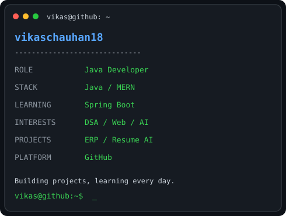

# 💫 About Me:
👨‍💻 I'm currently working on - Full Stack Web Development projects - Mern Stack projects  🤝 I'm looking to collaborate on - Web Development projects  🌱 I'm currently learning - Java DSA - Spring Boot - MERN Stack - SQL & Database Management  💬 Ask me about - Java - DSA - Web Development - Git & GitHub  ⚡ Fun fact - I enjoy building real-world projects and learning new technologies.

## 🌐 Socials:
   

# 💻 Tech Stack:
                        
# 📊 GitHub Stats:
 
 

## 🏆 GitHub Trophies

### ✍️ Random Dev Quote

### 🔝 Top Contributed Repo

---

<!-- Proudly created with GPRM ( https://gprm.itsvg.in ) -->

---

## 🚀 My GitHub Activity

<!-- Animated Terminal Profile -->
<h3 align="center">
  <code>vikas@github ~ $ whoami</code>
</h3>

  <code>Java Developer | Full Stack Developer | AI Enthusiast</code>

<table align="center">
  <tr>
    <td align="center" valign="top">
      
    </td>
    <td align="center" valign="top">
      
    </td>
  </tr>
</table>

## 🚀 Live Demo

**ERP Management System**

[🌐 Open Live Website](https://erp-management-frontend.onrender.com)

